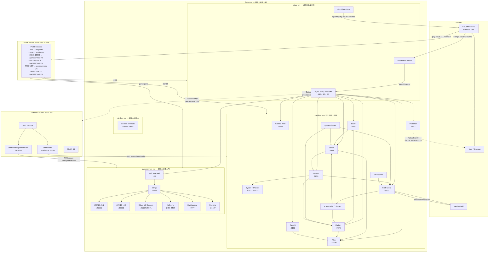

# server-stack

Self-hosted homelab stack running on Proxmox with two VMs backed by TrueNAS NAS over NFS.

## Infrastructure Overview



## Deployment targets

| Target | Status | Notes |
|---|---|---|
| Docker Compose — `media-vm` (app stack) | **Active production** | `compose/docker-compose.yml` — Plex, Sonarr, Radarr, Prowlarr, Seerr, Tautulli, Calibre-Web, RDT, Byparr, Portainer |
| Docker Compose — `edge-vm` (ingress) | **Active production** | `compose/docker-compose.edge.yml` — Nginx Proxy Manager, cloudflared, cloudflare-ddns |
| Docker Compose — `gameservers-vm` | **Active production** | `compose/docker-compose.gameservers.yml` — Pelican Panel + Wings |
| Native systemd (`serverhub`, Debian 12) | **Decommissioned** | Historical reference only. `services/*.service` units kept for documentation. serverhub was physically decommissioned 2026-10-21. |

See `compose/README.md` for Docker startup instructions.
See `docs/migration.md` for the historical cutover runbook (migration complete as of 2026-10-19).

Architecture and hardware docs:
- `docs/storage.md` — TrueNAS NAS, ZFS pool layout, expansion guide
- `docs/proxmox-compute.md` — Proxmox VM layout, GPU passthrough, devbox workflow
- `docs/homelab-hardware.md` — hardware BOM
- `docs/migration.md` — historical cutover runbook (completed)

## Media

| Service | Purpose | Port | Docs |
| --- | --- | --- | --- |
| Radarr | Movie management | 7878 | [Install & Config](docs/radarr.md) |
| Sonarr | TV show management | 8989 | [Install & Config](docs/sonarr.md) |
| Prowlarr | Indexer management | 9696 | [Install & Config](docs/prowlarr.md) |
| rdt-client | Real-Debrid download client | 6500 | [Install & Config](docs/rdt-client.md) |
| FlareSolverr | Cloudflare bypass proxy (Chromium, deprecated in favor of Byparr; install only if needed) | 8191 | [Install & Config](docs/flaresolverr.md) |
| Byparr | Cloudflare bypass engine (Firefox/Camoufox) | 8192 | [Install & Config](docs/byparr.md) |
| byparr-unwrap | Sidecar that strips Byparr's Firefox plaintext-viewer wrapper from JSON/XML responses (required when any byparr-proxy instance fronts a JSON/RSS indexer such as apibay) | 8193 | [Install & Config](docs/byparr-unwrap.md) |
| byparr-proxy | HTTP passthrough fronting Cloudflare-Turnstile indexers (1337x, apibay) so Prowlarr never triggers its broken cookie-replay path | 8881+ | [Install & Config](docs/byparr-proxy.md) |
| Decluttarr | Queue cleanup for failed/stalled downloads | - | [Install & Config](docs/decluttarr.md) |
| queue-cleaner | Sidecar for stuck rdt-client 500 queue items | - | [Install & Config](docs/queue-cleaner.md) |
| ClamAV | Malware scanning | - | [Install & Config](docs/clamav.md) |

Plex, Seerr (formerly Overseerr), Tautulli, and Calibre-Web are all managed by this stack via the `media` profile in `compose/docker-compose.yml`.

### How it works

```
Seerr -> Radarr/Sonarr -> Prowlarr -> rdt-client -> Real-Debrid -> local download -> Plex
```

1. A user requests content in Seerr
2. Seerr sends the request to Radarr (movies) or Sonarr (TV)
3. Radarr/Sonarr asks Prowlarr to search configured indexers for a matching torrent
4. The torrent is sent to rdt-client which pushes it to Real-Debrid
5. Real-Debrid debrids the torrent and serves a direct download link
6. rdt-client downloads the file to the local downloads directory
7. Radarr/Sonarr detects the completed download, renames and moves it to the media library
8. Plex picks up the new file automatically

Decluttarr runs alongside this pipeline. If Real-Debrid rejects a torrent
(for example as an infringing hash), rdt-client returns a 500 that Sonarr
and Radarr mistake for a transient connection error, leaving the item stuck
in the queue. Decluttarr detects the stall, blocklists the release, and
re-triggers the search so the pipeline can move on.

queue-cleaner is a small purpose-built sidecar that targets one specific
variant decluttarr does not catch out of the box: queue items left with
`status=warning` and `errorMessage="qBittorrent is reporting an error"`.
It runs every 5 minutes via a systemd timer and deletes + blocklists those
items. See [queue-cleaner docs](docs/queue-cleaner.md) for the full rationale.

### Requirements

- Ubuntu 24.04 LTS (media-vm and edge-vm)
- An active Real-Debrid premium subscription
- sudo access

### Installation

This stack is installed manually. Follow the docs in order:

1. [Permissions](docs/permissions.md) - set up the media user and directory structure first
2. [rdt-client](docs/rdt-client.md) - install the download client
3. [Radarr](docs/radarr.md) - install the movie manager
4. [Sonarr](docs/sonarr.md) - install the TV show manager
5. [Prowlarr](docs/prowlarr.md) - install the indexer manager and connect it to Radarr/Sonarr
6. [Decluttarr](docs/decluttarr.md) - install queue cleanup for failed/stalled downloads
7. [queue-cleaner](docs/queue-cleaner.md) - install the rdt-client 500 sidecar
8. [FlareSolverr](docs/flaresolverr.md) - optional, deprecated in this stack (kept as reference for the Chromium bypass path; only install if you have a specific classic-CF indexer that needs it)
9. [Byparr](docs/byparr.md) - install the Firefox-based Cloudflare bypass engine (required if you need any Turnstile-protected indexer)
10. [byparr-unwrap](docs/byparr-unwrap.md) - sidecar required if any byparr-proxy instance fronts a JSON / RSS indexer (e.g. the shipped apibay instance). Skip if only running HTML indexers like 1337x.
11. [byparr-proxy](docs/byparr-proxy.md) - install one instance per Turnstile-protected indexer (1337x, apibay, etc.); shipped definitions cover both
12. [ClamAV](docs/clamav.md) - install malware scanning (optional)

### File structure (Docker — current production)

NFS mounts on media-vm (from TrueNAS 192.168.1.164):
```
/mnt/media/
    movies/         <- Radarr root folder
    tv/             <- Sonarr root folder
    music/
    audiobooks/
    books/          <- Calibre-Web library
    downloads/
        radarr/     <- Radarr category download folder
        sonarr/     <- Sonarr category download folder
```

Docker named volumes on media-vm (in `/var/lib/docker/volumes/server-stack_*/`):
```
plex-config, tautulli-config, overseerr-config, calibre-config,
sonarr-config, radarr-config, prowlarr-config, rdt-client-config,
portainer-data
```

> **Legacy native-install paths** (`/mnt/raid0/media/`, `/opt/Radarr/`, etc.) were
> used on the decommissioned serverhub host. They are preserved in per-service docs
> as historical reference only.

### Permissions

All services run as a single `media` user. Plex and your personal user are added
to the `media` group for read access to the library. See [permissions](docs/permissions.md)
for full details.

### Service management

```bash
# Check status (on media-vm)
docker compose --profile media --profile indexers --profile cloudflare-bypass ps

# Restart a service
docker restart radarr

# View logs
docker logs radarr -n 50 --follow
```

> Native systemd commands (`systemctl`, `journalctl`) applied to the decommissioned serverhub. See `services/` for historical unit files.

### Known issues

- rdt-client creates a subfolder per download (e.g. Show.S01E01.mkv/Show.S01E01.mkv).
  Running all services as the same media user means Sonarr and Radarr can read these
  nested folders directly without any issues.
- FlareSolverr effectiveness depends on Chromium version. See
  [FlareSolverr docs](docs/flaresolverr.md) for details. It is deprecated
  in this stack in favor of Byparr; see [Byparr docs](docs/byparr.md).
- Prowlarr's FlareSolverr indexer proxy harvests cookies from the bypass
  solver then replays the request directly. Sites using Cloudflare
  **Turnstile** (1337x, apibay/ThePirateBay, kickass mirrors) issue no
  `cf_clearance` cookie, so the replay fails regardless of solver. See
  [Byparr - Prowlarr cookie-replay limitation](docs/byparr.md#prowlarr-cookie-replay-limitation).
  Work around it per Turnstile site with [byparr-proxy](docs/byparr-proxy.md),
  which fronts the site as a plain HTTP indexer Base URL so Prowlarr
  never enters the cookie-replay path.
- Sonarr can show No indexers available if Prowlarr sync fails. See
  [Prowlarr troubleshooting](docs/prowlarr.md) for details.

## Network

| Service | Purpose | Docs |
| --- | --- | --- |
| cloudflare-ddns | Dynamic DNS updater for grey-cloud Cloudflare records (edge-vm) | [Install & Config](docs/dns-updater.md) |
| cloudflared | Cloudflare Tunnel for public orange-cloud services (edge-vm) | — |
| Nginx Proxy Manager | Reverse proxy + SSL termination (edge-vm) | — |
